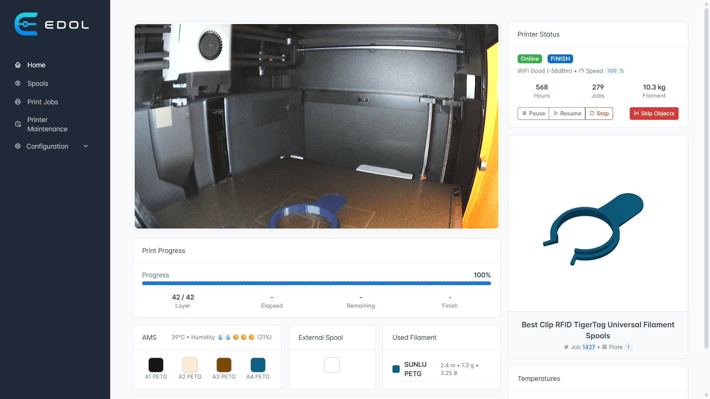

# EDOL

EDOL is a self-hosted system for Bambu Lab printer monitoring, print history,
filament inventory, spool allocation, maintenance, camera/model media and
Telegram notifications. Core connects directly to a reachable printer or
through an EDOL Agent. AMS terminals support printer-scoped spool workflows.



## Current architecture

The Java 21 / Spring Boot 4 Maven reactor contains:

| Module | Responsibility |
| --- | --- |
| `edol-core-api` | Shared runtime and AMS DTOs |
| `edol-core` | Printer connections, telemetry, commands, agents and media |
| `edol-hub` | Web dashboard, users, tenants, inventory and print history |
| `edol-notify` | Tenant Telegram integration |
| `edol-ams` | AMS workflows and terminal enrollment |

PostgreSQL 17 stores application and identity data. Mosquitto handles MQTT.
Secure installations also run Keycloak with the bundled EDOL login theme.
See [architecture](docs/architecture.md) and [tenant ownership](docs/contracts/tenant-ownership.md).

## Choose an installation mode

| Mode | Intended use | Identity and access |
| --- | --- | --- |
| `home` | One owner on a trusted private network | Installation tenant; no OIDC registration; keep every endpoint private |
| `secure` | HTTPS access with multiple isolated tenants | Keycloak OIDC, verified email, OWNER membership, service identities and forced database RLS |

Secure Dev functional testing has been completed by the owner. The production
cutover and legacy-data restore require their own acceptance. Deployment code
and readiness checks alone do not establish Internet-facing or physical-device
acceptance.

## Fresh installation

Use a Linux Docker host with Docker Compose v2 (`up --wait` support), Python
3.11+, OpenSSL, Git and tar. Source builds use the supplied Dockerfiles;
a host Java/Maven installation is needed only for local development.

Clone this repository into a source directory separate from persistent state.
For example, with an accessible repository URL:

```bash
git clone <your-repository-url> ~/edol-source
cd ~/edol-source
sudo install -d -m 0700 -o "$(id -un)" -g "$(id -gn)" /srv/edol
install -d -m 0700 /srv/edol/releases /srv/edol/home
python3 docker/deploy/init_config.py --environment prod --mode home \
  --output /srv/edol/home/instance.json
```

Review the generated private address, ports and subnet in a protected editor.
Keep the generated passwords. Then deploy Home from the reviewed checkout:

```bash
revision="$(git rev-parse HEAD)"
python3 docker/deploy/dev_deploy.py deploy-prod --mode home \
  --config /srv/edol/home/instance.json --revision "$revision" \
  --source-generation "$(git rev-list --count HEAD)"
```

Open the private `hub_origin` from the configuration and add a printer. Home
requires a trusted network; do not publish its ports to the Internet.

For **Secure production**, follow the complete
[production installation and cutover runbook](docs/operations.md#production-installation-and-cutover):
create independent secrets and MQTT trust, configure public HTTPS and SMTP,
then render and deploy. All example domains, addresses and ports are operator
inputs; third-party installations must replace them. Gitea is optional for a
manual installation.

The first deployment provisions empty databases and immutable migrations. It
creates no application account, printer, filament, spool or print history.
Secure users register, verify their email and receive a personal tenant with
OWNER access on first login. Add printers through Hub; pairing and enabling
connections are explicit steps. Configure Telegram in the tenant's settings.

Later deployments preserve databases, device bindings, broker authority,
installation keys and media. Protect the entire instance configuration,
certificate/key directories, state, retained source releases and PostgreSQL
volume. Never use `docker compose down -v` as an update procedure.

## Updates and CI

Gitea PRs targeting `main` run deployment/realm checks, the full Maven reactor
(including Docker-dependent tests) and SonarQube Quality Gate. A push to `main`
repeats those checks for the resulting commit; only a successful `build` job
permits automatic `prod-deploy`. Protect `main` against direct pushes and
require the CI status. Production SSH secrets are separate from Dev secrets.

Dev deployment remains manual (`dev-secure-deploy` / `dev-home-deploy`).
Production changes use the independent `/srv/edol` instance. See
[operations](docs/operations.md) for server preparation, secrets, ingress,
backups, readiness, failure recovery and legacy-data migration gates.

Upgrading a legacy single-tenant installation requires a coordinated backup,
an isolated restore rehearsal and an explicit mapping to the new tenant and
printer. Do not restore an old full database over a registered Secure instance
or run the current migrations blindly against the old production volume.

## Development

Use JDK 21, Maven and an available Docker daemon for migration/RLS tests:

```bash
mvn -B clean verify
python3 -B -m unittest discover -s docker/deploy/tests
node docker/keycloak/realm/validate-realm-schema.mjs
```

Printers need supported LAN access and compatible firmware/settings. The
application does not bypass vendor authorization restrictions. Register
connection details in Hub; old single-printer `BAMBU_*` environment setup and
NanoMQ Compose instructions are retired.

[Operations](docs/operations.md) · [Architecture](docs/architecture.md) ·
[Agent pairing](docs/contracts/agent-pairing.md) ·
[Agent MQTT](docs/contracts/agent-mqtt.md)
